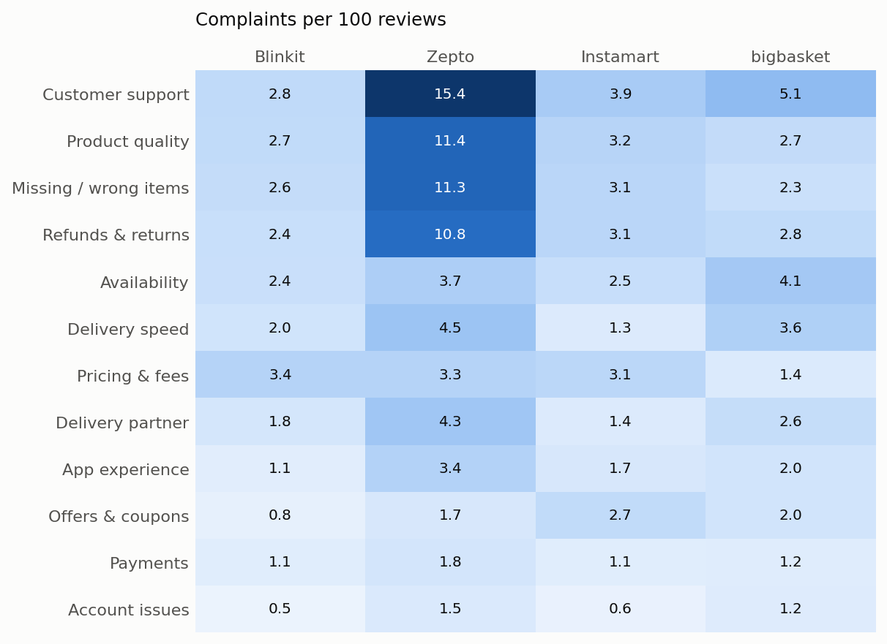
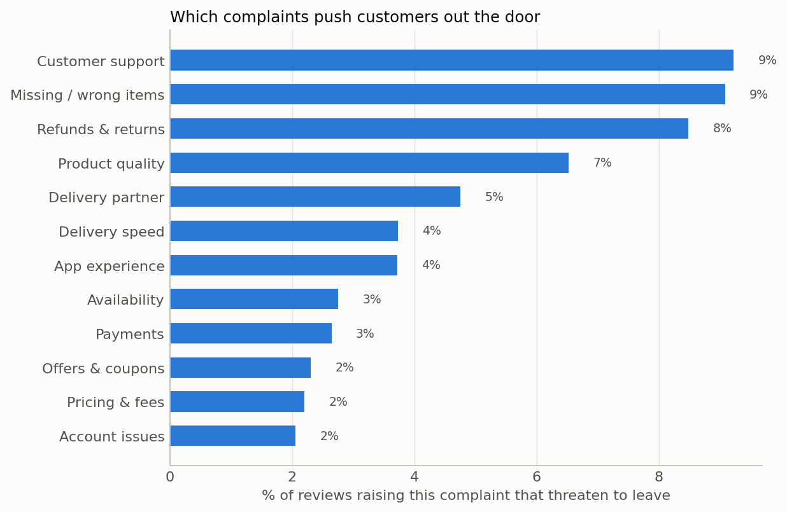
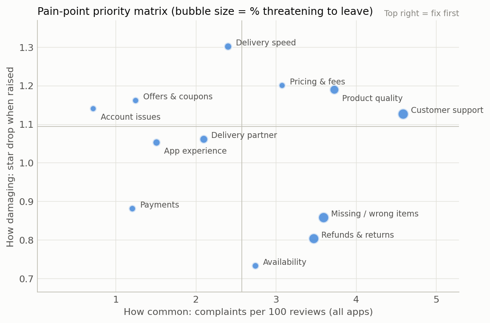

# What India's quick-commerce customers complain about

A voice-of-customer study of **128,229 Google Play reviews** of Blinkit, Zepto, Swiggy Instamart and bigbasket
(27 Jul – 25 Sep 2026). It uses an LLM to read reviews (including Hinglish) and answers three business questions:

1. **What** do customers complain about, app by app?
2. **Which** complaints hurt ratings and push customers to leave?
3. **What** should each app fix first?

The full executive report is in [`outputs/report.html`](outputs/report.html) (download and open in a browser).

## Key findings

**1. Zepto has a recovery problem, not a speed problem.** Zepto rates 3.29★ against 4.06–4.15★ for its peers, and
39% of its reviews are 1-star (peers: 16–17%). The gap is not delivery speed, which is the category's headline
promise. It is what happens *after* an order goes wrong. Per 100 reviews, Zepto gets about 4× the peer average of
complaints about customer support, product quality, missing or wrong items, and refunds.



**2. The same after-sales loop drives churn.** The complaints most often paired with "I'm uninstalling" or "I'm
switching" are customer support (9.2% of reviews raising it), missing or wrong items (9.1%) and refunds (8.5%).
Pricing complaints are common but rarely come with a threat to leave (2.2%).



**3. Prioritise by frequency × damage.** Customer support is the most common complaint in the category. Delivery
speed does the most damage per mention: a review raising it scores 1.3 stars lower, all else equal.



**4. Replying is not resolving.** Every app answers 93–99% of 1–2★ reviews within a median of about 12 minutes,
which points to templated replies. Reply rate is therefore a vanity metric. Resolution quality is the one to manage.

**5. bigbasket is getting worse.** Over the last 4 weeks, bigbasket's complaints about customer support, delivery
speed and delivery partners rose the most of any app.

### Recommendation: one priority fix per app

| App | Fix first | Owner | Why |
|---|---|---|---|
| Zepto | Customer support and complaint resolution | Customer support | ~4× peer complaint rate; the top churn trigger |
| bigbasket | Customer support, then delivery reliability | Customer support, last-mile ops | Largest recent increases |
| Instamart | Customer support; clarity of ₹1 deals and offers | Customer support, marketing | Highest offers/coupons complaint rate |
| Blinkit | Pricing and fees transparency | Pricing | Its most common complaint; low churn risk |

## How it works

| Step | What happens | Code |
|---|---|---|
| Collect | 60 days of public Play Store reviews per app; reviewer names and photos dropped at collection | `src/scrape.py` |
| Clean | Normalise text; flag reviews with 6+ words as classifiable (30% of reviews) | `src/clean.py` |
| Label | An LLM labels a stratified sample (500 per app) against a 12-topic taxonomy built around the customer journey: sentiment, complaints, praise, churn intent, and the competitor named | `src/label_llm.py`, `src/taxonomy.py` |
| Scale | A TF-IDF (word + character n-grams, robust to Hinglish spelling) + logistic-regression classifier learns from the LLM labels and labels every review | `src/train_classifier.py` |
| Validate | 5-fold out-of-fold agreement with the LLM labels; optional blind hand-labelled check of the LLM itself | `src/train_classifier.py`, `src/gold.py` |
| Analyse | Complaint rates, rating impact (OLS with app fixed effects), churn triggers, week-on-week trends, reply behaviour | `src/analyze.py` |
| Present | Executive report + interactive Streamlit dashboard | `src/report.py`, `app/dashboard.py` |

**Why an LLM plus a small classifier?** Labelling all 128k reviews with an LLM would be slow and costly. Labelling
2,000 and distilling those labels into a classifier costs almost nothing per review. The classifier reproduces the LLM's
complaint labels with a macro F1 of 0.69 (0.83–0.86 on the largest topics: pricing, refunds, support) and
3-class sentiment with a macro F1 of 0.84. Per-label scores are in [`outputs/classifier_report.csv`](outputs/classifier_report.csv).

**How the labels in this run were produced.** The 2,000 sample labels were produced by Claude (Anthropic) in an
interactive session, following the same taxonomy and rules that `src/label_llm.py` sends to the Claude API. Running
`label_llm.py` with an API key regenerates them automatically; the rest of the pipeline is unchanged.

## Run it

```bash
pip install -r requirements.txt
cp .env.example .env              # add your Anthropic API key
python run_pipeline.py            # scrape -> clean -> label -> train -> analyze -> report
streamlit run app/dashboard.py    # interactive dashboard
```

## Limitations

- App-store reviewers skew towards extreme experiences, so the rates describe reviewers, not all customers.
- Rating impact comes from a regression. It shows association, not causation.
- The classifier is weakest on rare or vague topics (app experience, delivery partner). Findings rest mainly on the
  larger topics, where agreement is high.
- The switching analysis uses only the 95 sampled reviews that name a competitor, so it is directional.
- Raw review text is not committed to this repository; only code and aggregated results are published.
